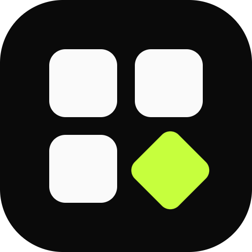
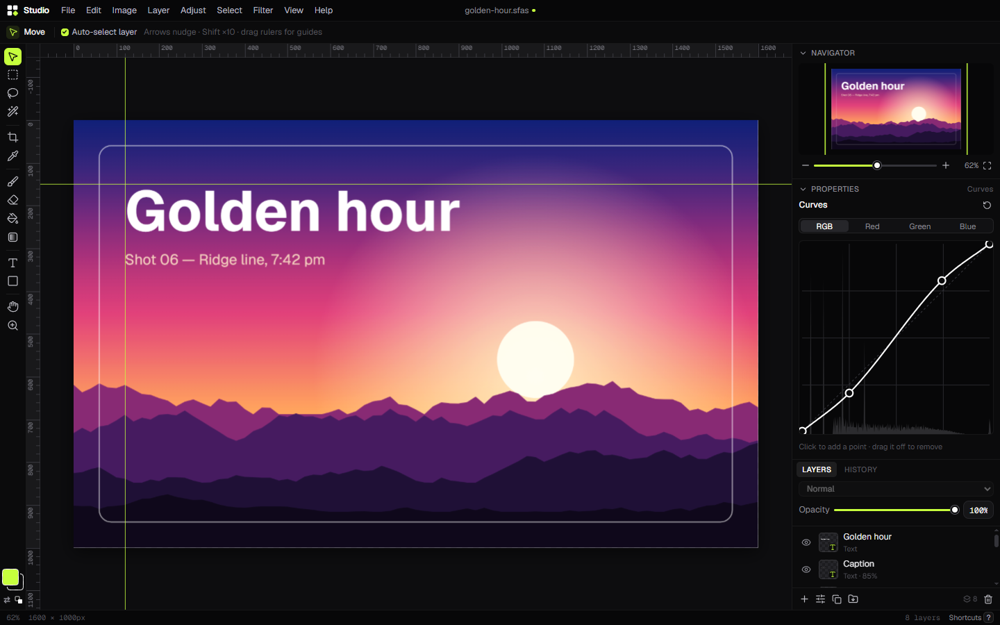
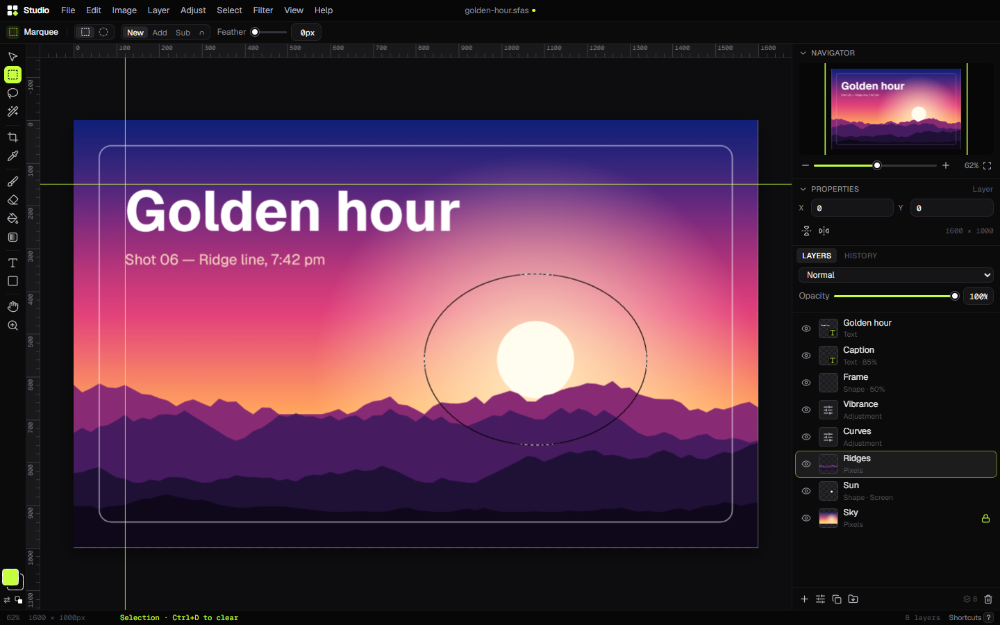

<p align="center">
  
</p>

<h1 align="center">SFA Studio</h1>

<p align="center">A free, open-source layered photo editor for Windows and the web.</p>

<p align="center">
  <a href="https://github.com/bbeaudroit/sfa-studio/releases/latest/download/SFA-Studio-Setup.exe"><b>Download for Windows</b></a>
  ·
  <a href="https://github.com/bbeaudroit/sfa-studio/releases">All releases</a>
  ·
  <a href="https://sforall.vercel.app">Made by SFA</a>
</p>


| Curves with live histogram | Selections |
| --- | --- |
|  |  |

## Features

**Files**
- Open, drag in or paste PNG, JPG, WebP, GIF, BMP, AVIF.
- Export PNG, JPG and WebP with quality, scale and a live file-size estimate.
- `.sfas` project files keep every layer editable (a zip of `document.json` + PNG layers).
- Windows installer with file associations for `.png`, `.jpg`, `.webp` and `.sfas`.

**Layers**
- Pixel, text, shape and adjustment layers.
- Add, delete, duplicate, rename, drag to reorder, hide, lock.
- Opacity and 16 blend modes. Merge down, merge visible, flatten, rasterize.
- Ctrl+J copies the selection to a new layer. Ctrl+click a thumbnail to select its pixels.

**Tools**
- Move (auto-select, nudge, move selected pixels), rectangle/ellipse marquee, freehand and polygon lasso, magic wand.
  Selections can add, subtract, intersect, feather and invert.
- Crop with aspect presets, plus rotate, flip, image size and canvas size.
- Brush and eraser with size, hardness, opacity and pen pressure. Fill bucket, linear/radial gradient, eyedropper.
- Text with any installed font, weight, size, color, alignment and leading. Text stays editable.
- Rectangle (with corner radius), ellipse and line. Shapes stay editable.

**Adjustments** (non-destructive layers): brightness/contrast, levels, curves (RGB + per channel), exposure, vibrance, hue/saturation, black & white, invert.
**Filters** with live preview: Gaussian blur, sharpen (unsharp mask), noise. They respect the selection.

**Workspace**: undo/redo with a history panel, navigator with zoom slider, rulers and draggable guides, pixel grid at high zoom, shortcuts close to what designers already know.

## Keyboard shortcuts

| Tools | | Edit | |
| --- | --- | --- | --- |
| Move | `V` | Undo / Redo | `Ctrl+Z` / `Ctrl+Shift+Z`, `Ctrl+Y` |
| Marquee (Shift+M cycles) | `M` | Copy / Cut / Paste | `Ctrl+C` / `Ctrl+X` / `Ctrl+V` |
| Lasso | `L` | Select all / Deselect / Inverse | `Ctrl+A` / `Ctrl+D` / `Ctrl+Shift+I` |
| Magic wand | `W` | Delete selection | `Delete` |
| Crop | `C` | Fill with foreground | `Alt+Backspace` |
| Eyedropper | `I` | New layer | `Ctrl+Shift+N` |
| Brush / Eraser | `B` / `E` | Duplicate layer | `Ctrl+J` |
| Fill / Gradient | `G` | Merge down | `Ctrl+E` |
| Text | `T` | Levels / Curves / Hue-Sat | `Ctrl+L` / `Ctrl+M` / `Ctrl+U` |
| Shape (Shift+U cycles) | `U` | Save / Save as | `Ctrl+S` / `Ctrl+Shift+S` |
| Hand / Zoom | `H` / `Z` | Export | `Ctrl+Shift+E` |
| Brush size / hardness | `[` `]` / `Shift+[` `]` | Fit / 100% | `Ctrl+0` / `Ctrl+1` |
| Swap / default colors | `X` / `D` | Rulers / Guides | `Ctrl+R` / `Ctrl+;` |
| Pan | hold `Space` | All shortcuts | `?` |

## Build from source

Requires Node 20+.

```bash
git clone https://github.com/bbeaudroit/sfa-studio.git
cd sfa-studio
npm install
```

```bash
npm run dev        # web app at http://localhost:5181
npm run electron   # desktop app with hot reload
npm run dist       # Windows installer -> release/SFA-Studio-Setup.exe
```

`npm run icons` regenerates the app icon and installer art in `build/`. `npm run shots` regenerates the README screenshots from the built app.

The installer is not code-signed yet, so Windows SmartScreen may ask you to confirm the first run (More info → Run anyway).

## Project layout

```
electron/        main process + preload (file dialogs, file associations)
src/core/        document model, history, compositing, adjustments, filters, selection, file format
src/tools/       canvas tools
src/ui/          React UI: menus, panels, dialogs
scripts/         icon/installer art and screenshot generators
```

The document is immutable; pixel edits are recorded as before/after patches, so undo is cheap even on large images.

## Roadmap

- Layer masks and clipping
- Free transform (scale/rotate) for layers
- Multiple documents in tabs
- Healing / clone stamp
- Layer groups and layer styles (shadow, stroke)
- PSD import
- WebGL compositing for very large images
- macOS and Linux builds

## Contributing

Issues and pull requests are welcome. Keep changes focused, run `npm run typecheck` before opening a PR, and match the existing style. For larger features, open an issue first so we can agree on the approach.

## License

[MIT](LICENSE) © SFA (Software For All)
